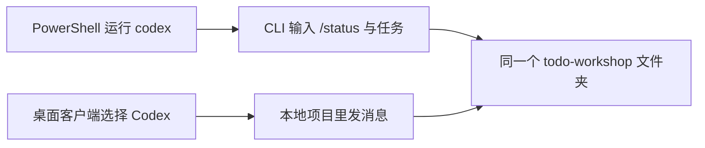
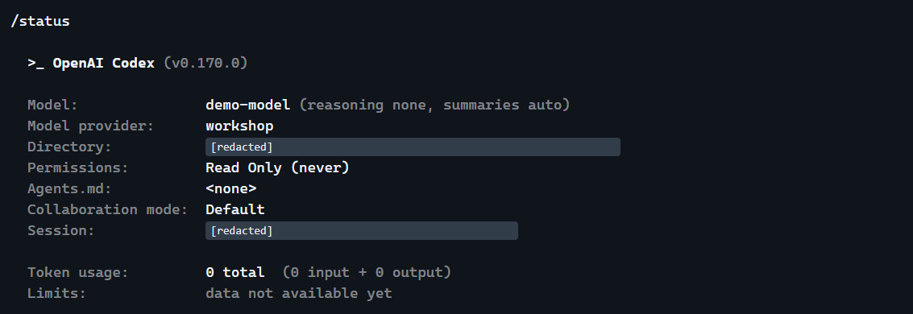

# 01 安装，打开同一个练习

后面的章节会明确区分三个输入位置。**PowerShell** 运行 `git`、`node`、`codex` 等命令。运行 `codex` 后，你进入 **Codex CLI**，在里面输入 `/status` 或用中文描述任务。**桌面客户端**指 ChatGPT 桌面应用里的 Codex 界面，在聊天输入框发送提示词。

## 安装 CLI

1. 从官方渠道安装 [Git for Windows](https://git-scm.com/install/windows)、[Sourcetree](https://www.sourcetreeapp.com/) 和 [Node.js](https://nodejs.org/en/download)。安装后，新开一个 PowerShell 窗口。
2. 在 PowerShell 运行下面的命令。前三条分别检查 Git、Node.js 和 npm，第四条安装 CLI。

   ```powershell
   git --version
   node --version
   npm --version
   npm install -g @openai/codex
   codex --version
   ```

3. 运行 `codex`，首次打开时按界面提示选择使用 ChatGPT 登录。登录完成后，可在 Codex CLI 输入 `/quit` 回到 PowerShell。

安装后若提示找不到命令，先关闭并重开 PowerShell。若 PowerShell 明确提示 npm 安装的 `codex.ps1` 无法运行，可试 `codex.cmd --version` 和 `codex.cmd`。相关入口见 [Codex CLI 官方指南](https://learn.chatgpt.com/docs/codex/cli)。

## 安装桌面客户端

在 [Windows 桌面应用官方指南](https://learn.chatgpt.com/docs/windows/windows-app) 下载并安装 ChatGPT 桌面应用，登录后从 ChatGPT 下拉菜单选择 **Codex**。先用 CLI 做基础练习。在第 04 章体验 Computer Use，或到第 05 章用 **Add new project**（`Ctrl+O`）打开同一个练习目录。



## 准备独立的待办练习

如果你在 GitHub 上看教程，回到仓库首页选择 **Code → Download ZIP**，解压后找到含有 `README.md` 和 `practice` 的目录。在 PowerShell 用 `Set-Location` 进入它，路径含空格时用引号包起来，可以从资源管理器复制路径。

运行 `Get-ChildItem` 确认位置。下面的命令把练习复制到一个单独的文件夹，然后显示路径。若提示 `todo-workshop` 已存在，把目录名换成一个未使用的名字后再运行。

```powershell
$workshop = Join-Path $env:USERPROFILE 'todo-workshop'
if (Test-Path -LiteralPath $workshop) { throw 'todo-workshop 已存在，请换一个目录名。' }
Copy-Item -LiteralPath .\practice -Destination $workshop -Recurse -ErrorAction Stop
Set-Location -LiteralPath $workshop
Get-Location
```

打开 [Sourcetree 教程总结（飞书）](https://gcn3z3rurfcz.feishu.cn/wiki/DLA9wWr8Li77OYkwOcxc4YD9n1b)，并在 Sourcetree 新标签页用 **Create** 在刚才的目录创建本地 Git 仓库。若 Create 无法选中已有目录，在这个目录运行 `git init`，再回 Sourcetree 用 **Add** 打开。

在 **File Status** 中只选 `todos.mjs`、`todos.test.mjs` 和 `todos.json`，确认三项都出现在 **Staged files**，填写 `Save todo exercise baseline` 后点 **Commit**。暂存就是选定哪些改动进入下一次提交。在 **Log / History** 看到这条提交就完成了，提交记录保存在本机。界面操作可参照 [Atlassian 的 File Status 说明](https://support.atlassian.com/sourcetree/kb/viewing-file-status-of-a-repository/)。

回到 PowerShell，运行以下命令。预期程序打印三条待办，测试末尾有 `pass 1` 和 `fail 0`。

```powershell
node .\todos.mjs
node --test
```

```text
待办清单
[x] 安装 Codex
[ ] 读懂 Git 差异
[ ] 完成 Skills 实战
```

在 PowerShell 运行 `Get-Location` 确认当前位置，然后运行 `codex`。在 Codex CLI 输入 `/status`，看 `Directory` 是否指向 `todo-workshop`。下面是独立演示环境中实际的 CLI 画面，模型名为示例，目录和会话 ID 已遮挡。



确认目录后，进入 [02 CLI 最常用的指令](02-cli.md)。
