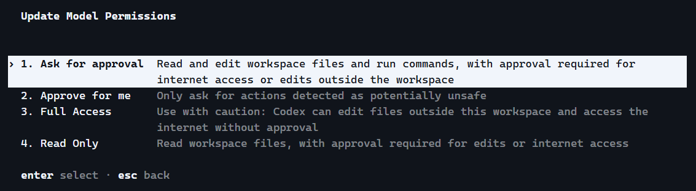
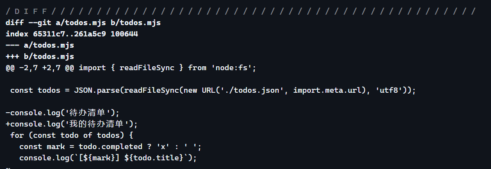

# 02 CLI 最常用的指令

在 PowerShell 回到 `todo-workshop`。先运行 `Get-Location` 确认位置，再运行 `codex`。下面这些带 `/` 的指令输在 **Codex CLI 的输入框**。

| 输入 | 何时用 |
| --- | --- |
| `/status` | 核对会话目录、模型和权限信息 |
| `/permissions` | 查看或切换权限，第一次读代码可选 **Read Only** |
| `/model` | 查看并选择当前对话可用的模型 |
| `/mention` | 把指定文件带入提示词，例如选中 `todos.mjs` |
| `/plan` | 开工前先让 Codex 给方案，确认范围和验收步骤 |
| `/diff` | 看当前工作区的文件改动 |
| `/review` | 请求 Codex 审查尚未提交的改动 |
| `/new`、`/resume` | 开一段新对话，或接着做已有对话的任务 |
| `/worktree` | 让一个任务在独立目录里改代码，见 [Git 与 Worktree](git-and-worktrees.md) |
| `/skills` | 浏览可用的 skills，也可输入 `$` 选择 |
| `/quit` | 返回 PowerShell |

输入 `/` 可打开本机版本的命令列表。界面和选项名称以本机版本为准。参见 [CLI 斜杠指令](https://learn.chatgpt.com/docs/developer-commands?surface=cli)。

## 从读代码到改一行

先在只读权限下用 `/mention` 选 `todos.mjs`，再发送下面这段。

```text
请看 todos.mjs、todos.json 和 todos.test.mjs。说清待办数据在哪里、如何打印、如何运行测试。不修改文件。
```

核对它是否指出 `todos.json` 是数据、`todos.mjs` 是入口、`node --test` 是测试命令。然后用 `/permissions` 选择 **Ask for approval**，允许写入练习目录、超出权限时请求批准。



再发下面这段。

```text
只改 todos.mjs，把列表标题从「待办清单」改成「我的待办清单」。保留三条任务和它们的顺序。运行 node todos.mjs 和 node --test，告诉我实际结果。
```

输入 `/diff` 查看差异。也可以用 `/review` 选审查未提交的改动，得到一份额外检查。

下面是演示副本中的实际 `/diff` 画面。`-` 行是旧标题，`+` 行是新标题。回到 Sourcetree，打开练习仓库的 **File Status**，点选 `todos.mjs` 看同一处差异，并检查文件列表里是否只有这一个改动。



在 PowerShell 自己验收实际输出，应显示「我的待办清单」，三行任务保持原样，测试通过。

```powershell
node .\todos.mjs
node --test
```

## 练习撤回

在 Sourcetree 的 **File Status** 里点开 `todos.mjs`，确认只有刚做的标题改动。它应还在未暂存区。对这一处差异点 **Discard Hunk**。若版本只有文件级的 **Discard**，先确认该文件里的改动都可丢弃。再运行 `node .\todos.mjs`，确认回到「待办清单」。[Sourcetree File Status 说明](https://support.atlassian.com/sourcetree/kb/viewing-file-status-of-a-repository/)

接下来做 [Git 与 Worktree](git-and-worktrees.md)。
