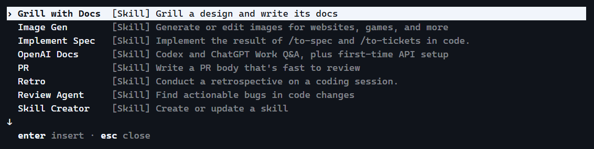
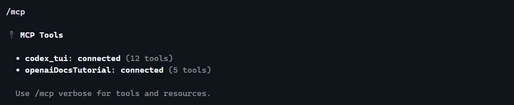

# 03 Codex 配置与 Magpie

## 配置写在哪里

| 文件 | 它解决的问题 | 练习里的例子 |
| --- | --- | --- |
| `~/.codex/config.toml` | 当前用户的 Codex 设置 | 设置个人的默认权限 |
| `.codex/config.toml` | 受信任项目的 Codex 设置 | 给特定项目设定工作区权限 |
| `AGENTS.md` | 告诉 Codex 进入这个项目后怎么工作 | 修改代码后运行 `node --test` |
| skill 文件夹里的 `SKILL.md` | 告诉 Codex 如何执行一套可复用的流程 | 先写失败的测试，再实现功能 |
| `.codex/rules/*.rules` | 决定符合条件的命令请求在沙箱外运行时怎么处理 | 批准前先询问 |
| `.codex/hooks.json` | 在指定事件发生时自动执行操作 | 启动新会话时显示练习提示 |
| `config.toml` 的 `[mcp_servers.*]` | 给 Codex 接入可调用的工具和数据 | 查询 OpenAI 官方文档 |

`~` 表示当前用户的主目录。在 PowerShell 可以运行 `notepad "$env:USERPROFILE\.codex\config.toml"` 打开默认位置的个人配置。若设置过 `CODEX_HOME`，个人配置位于那个目录。下面的示例允许在工作区写入，超出权限时可请求批准。参见 [Codex 配置指南](https://learn.chatgpt.com/docs/config-file/config-basic)。

```toml
sandbox_mode = "workspace-write"
approval_policy = "on-request"
```

先通过上节的 `/permissions` 体验效果。若确实要在配置文件里改，在已有文件里更新相同的顶层键，避免重复添加。组织管理的权限可以限制这些设置。

在 `todo-workshop` 根目录新建 `AGENTS.md`，复制下面两行并保存。开一个新对话，问 Codex「这个练习对运行测试有什么要求？」如果它能指出 `node --test`，就完成了项目规则的练习。这个文件也会在实战中用到。参见 [AGENTS.md 官方说明](https://learn.chatgpt.com/docs/agent-configuration/agents-md)。

```markdown
# 待办练习

修改代码后运行 `node --test`，并用简体中文概括实际验证结果。
```

## 安装 Magpie 并导入 Skills

本课把 Magpie 用作技能库。Codex 继续使用你在第一课完成的登录。


1. 打开 [Magpie 官方发布页](https://github.com/yetone/magpie-releases/releases)。在 **Assets** 选带图形界面的 Windows 包 `magpie-windows-amd64.exe`；如果系统是 ARM64，选 `magpie-windows-arm64.exe`。在 Windows 的「设置 → 系统 → 系统信息」可以查看系统类型。安装后打开 Magpie。
2. 进入 **Library → Skills**，从 GitHub 添加 `https://github.com/mattpocock/skills`。按 [第 05 章的准备清单](05-matt-pocock.md#实战前的准备) 选中主流程和依赖的技能，分发目标勾选 **Codex**。若结果只出现部分技能，可按名字逐个导入对应的 GitHub 文件夹。
3. 关闭并重新打开 Codex CLI，输入 `/skills` 后选择 **List skills**，或直接输入 `$tdd` 搜索。能看到并选中 `tdd` 就说明 CLI 能发现它。
4. 用下面的只读提示确认工作流可以调用。期望它说明 TDD 的顺序，并停在讨论阶段。

   ```text
   $tdd 请先解释你会怎样用红灯、绿灯验证这个项目的一个新功能。
   只说明步骤，不写测试、不修改文件。
   ```

如果 Magpie 显示已安装、Codex 只显示 `magpie-skills`，检查该 skill 是否经由 **Skill Router** 分发。要按本教程直接选中独立名称，把这几个技能设为 **Direct**，再开新对话。如果出现同名 skill，先确认它的来源，只保留一种分发方式。文件位置和分发模式见 [Magpie 技能库文档](https://usemagpie.ai/docs/library#skills)。原作者另有 [Codex 插件安装方式](https://github.com/mattpocock/skills#installation-30-second-setup)，已经从 Magpie 导入时可继续使用当前这一套。

下图是本机 Codex CLI 用演示项目中的技能文件打开的选择器。找到 **Grill with Docs** 对应的 `grill-with-docs` 后，按 Enter 可把它插入当前输入。



## 补充练习

这些小练习可以单独做。`AGENTS.md` 写日常约定，Skill 写可复用的步骤。需要约束命令、在某个事件自动执行操作，或接入外部工具时，再分别用 Rules、Hooks 和 MCP。

### Rules

`prefix_rule` 按命令及参数的开头匹配。这个示例只检查 `node --version`，当它请求在沙箱外运行时，`prompt` 表示先询问。

在练习目录保存一个 `demo.rules`。放在根目录方便用验证命令直接读取。如果将来要让规则随受信任的项目加载，配置入口是 `.codex/rules/`。参见 [Rules 官方说明](https://learn.chatgpt.com/docs/agent-configuration/rules)。

```python
prefix_rule(
    pattern = ["node", "--version"],
    decision = "prompt",
)
```

在 PowerShell 验证两个命令的匹配结果。验证只计算策略结果。第一条的 JSON 应显示 `prompt`，第二条应没有匹配规则。

```powershell
codex execpolicy check --pretty --rules .\demo.rules -- node --version
codex execpolicy check --pretty --rules .\demo.rules -- node --help
```

### Hooks

Hook 在特定事件发生时执行命令。下面的 `SessionStart` 示例在新会话开始时给你一条可见的提示。用单独的练习副本，从它的根目录启动 CLI。

在该副本的 `.codex` 文件夹里创建 `hooks.json` 和 `session-start.cjs`。将下方内容保存到 `.codex/hooks.json`。

```json
{
  "hooks": {
    "SessionStart": [
      {
        "matcher": "^startup$",
        "hooks": [
          { "type": "command", "command": "node .codex/session-start.cjs" }
        ]
      }
    ]
  }
}
```

将这行保存到 `.codex/session-start.cjs`。

```javascript
console.log(JSON.stringify({ systemMessage: '待办练习 Hook 已运行' }));
```

从副本根目录打开 Codex CLI，用 `/hooks` 查看来源，读完这两个文件再信任该 hook。退出并重新启动一个 CLI 会话，观察是否出现「待办练习 Hook 已运行」。如果列表为空，检查当前目录和该项目的信任状态。参见 [Hooks 官方说明](https://learn.chatgpt.com/docs/hooks)。

### MCP

MCP（Model Context Protocol）让 Codex 能调用外部工具。这里用只读的 OpenAI Docs MCP 查公开文档。

在 PowerShell 登记并检查服务。

```powershell
codex mcp add openaiDocsTutorial --url https://developers.openai.com/mcp
codex mcp list
```

重新打开 CLI，在 Codex 的输入框运行 `/mcp`，查看服务及工具是否可用。试发「用 `openaiDocsTutorial` 查官方文档，告诉我 `/status` 能看到什么，并给出来源」，核对对话里出现的 MCP 工具调用。参见 [MCP 配置指南](https://learn.chatgpt.com/docs/extend/mcp#connect-codex-to-an-mcp-server)和 [OpenAI Docs MCP](https://developers.openai.com/learn/docs-mcp)。



接下来可以做桌面客户端的 [04 Computer Use](04-computer-use.md)，也可以直接进入 [05 Matt Pocock Skills 实战](05-matt-pocock.md)。
