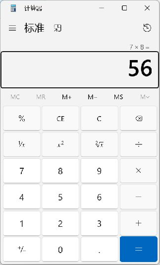

# 04 Computer Use（客户端选练）

本章使用 ChatGPT 桌面应用的 Computer Use。让 Codex 打开 Windows 计算器并验证 `7 × 8`，完成标志是**计算器窗口显示 `56`**。本章可选，可以直接进入 [05 Matt Pocock Skills 实战](05-matt-pocock.md)。


1. 打开 ChatGPT 桌面客户端，选择 **Codex**。
2. 到 **Settings → Computer use** 找到 **Any App** 或 **Computer Use** 的设置入口。按界面提示完成设置；若工作区有应用范围或权限限制，以它显示的选项为准。
3. 在 Windows 开始菜单打开「计算器」，切换到标准模式并保持窗口可见。回到 Codex 对话，发送下面的提示。若弹出权限提示，确认请求的应用是计算器。

   ```text
   请用 Computer Use 操作 Windows 的「计算器」窗口，用界面计算 7 × 8。
   按下等号后查看屏幕，告诉我窗口实际显示的结果。只操作计算器。
   ```

4. 看计算器里的数字，并对照下图。若没看到计算器被操作，检查客户端是否真正调用了 Computer Use、权限是否允许当前应用，以及计算器是否在当前活动桌面。官方入口见 [Computer Use 指南](https://learn.chatgpt.com/docs/computer-use)。



图为本机实际操作后的计算器窗口，只包含演示算式和结果。

接下来在同一个客户端做 [05 Matt Pocock Skills 实战](05-matt-pocock.md)。
