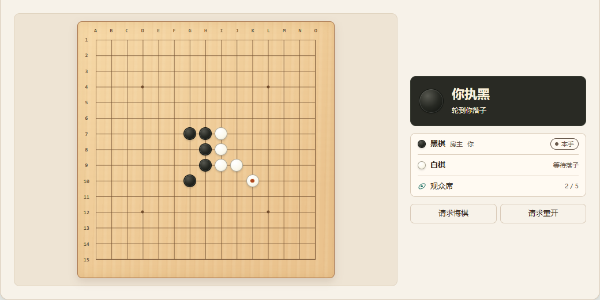
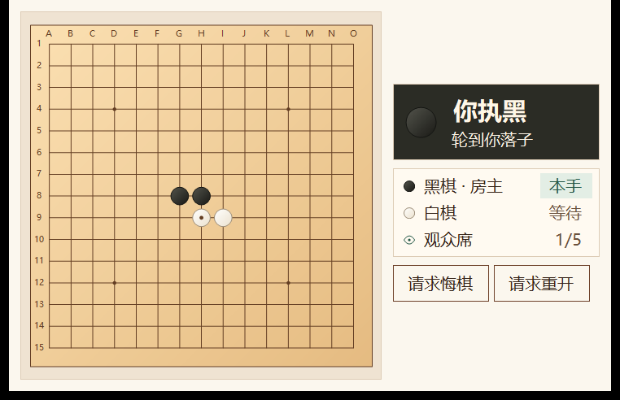

# 05 Matt Pocock Skills 实战 · Windows 五子棋

**任务目标**　在 Codex 桌面客户端从空的 Git 仓库做一个 Windows 五子棋。最小交付是双击 `Gomoku.exe`、创建人机房并下一局。想做完整版本，再加局域网对战、观战、弹幕和断线续局。本章用一次真实会话的截图、规格、工单和验收记录讲解。

原会话先做出了可玩的版本，试玩时才发现黑棋、白棋和观众在界面上不容易区分，于是补做了三个原型并选择 A 版。本课把**先试界面、再定规格**放进需求会话。想先练一个没有 GUI 的小任务，可以做[待办筛选短练习](matt-pocock-todo.md)。

**跟着原对话看**　[打开五子棋实战会话（HTML）](matt-pocock-session.html)。里面有脱敏的原话、A/B/C 原型和 Windows 实拍。跟练时把 `prototype` 放在 `grill-with-docs` 之后，选定方案再写规格。如果 GitHub 显示 HTML 源码，把仓库下载到本机后，用浏览器打开 `docs/matt-pocock-session.html`。

## 实战前的准备

1. 用 Sourcetree 为一个新的练习目录创建本地 Git 仓库，再用 Codex 桌面客户端打开它，选择 **Local** 开一个对话。做 Windows 版时，开发机需要 .NET 10 SDK，可用 `dotnet --list-sdks` 检查。[Git 与 Worktree](git-and-worktrees.md) · [.NET 10 下载](https://dotnet.microsoft.com/zh-cn/download/dotnet/10.0)
2. 用 [Magpie](03-config-and-magpie.md#安装-magpie-并导入-skills) 装主流程的 `grill-with-docs`、`prototype`、`to-spec`、`to-tickets`、`implement`、`implement-spec`、`diagnosing-bugs` 和 `retro`。一起装 `setup-matt-pocock-skills`、`triage`、`grilling`、`domain-modeling`、`tdd`、`code-review` 和 `writing-for-agents`。对话里输入 `$` 选技能，再接上提示词正文。[上游技能清单](https://github.com/mattpocock/skills)
3. 第一次在这个仓库用 Matt 的技能，发 `$setup-matt-pocock-skills 使用本地 Markdown，保留默认分流标签，用 AGENTS.md 和单一术语表。` 按界面提示确认。打开 `AGENTS.md`，核对它指向 `docs/agents/issue-tracker.md`、`docs/agents/triage-labels.md` 和 `docs/agents/domain.md`。以后规格和工单放进 `.scratch/`，标签和领域文档的约定也能从这三个入口找到。

## 在同一个对话完成需求与拆单

### 1. `grill-with-docs` 问清楚玩家能做什么

```text
$grill-with-docs 我想做一个 Windows 11 x64 的五子棋。发给朋友一个 exe，双击就能玩。
支持 15×15 棋盘、人机和同一局域网双人对战。请先分轮问我入房、观战、悔棋和断线怎么处理。
把确认的术语写进 GLOSSARY.md。方案确认前先停在讨论和原型阶段。
```

实战确认了三个会改变使用体验的决定。访客先入观众席，再选空位上席。房主建人机房时选难度，对局中固定。房主开房时可选断线立即中止或限时续局，等待范围是 15–180 秒，默认 30 秒。

打开项目根目录的 `GLOSSARY.md`，可以看到「对战席」和「观众席」各自指什么。讨论和测试都可以沿用这些名字。遇到以后难改的架构取舍时，还可用 ADR 记录决定和理由。

> **观众席**  
> 供玩家观看对局和发送弹幕的位置。其他玩家进入房间后默认在观众席，可以选择空闲的对战席参加对局。

摘自本次实战的 `GLOSSARY.md`。[上游 `grill-with-docs`](https://github.com/mattpocock/skills/blob/main/skills/engineering/grill-with-docs/SKILL.md)

### 2. `prototype` 对比三版，选定一版

```text
$prototype 先做一个可点的棋室原型，给我三版布局。
让我在同一页面切换 A/B/C、黑棋/白棋/观众，用同一局棋比较身份、轮次和操作入口。
等我选定，再把选中的布局与交互要求整理成可写进规格的结论。
```

打开原型，用三个身份各看一遍。黑棋和白棋能否一眼认出自己的身份和当前轮次？观众能否直接找到弹幕输入？实战提供了三种布局。

| 方案 | 打开后看什么 |
| --- | --- |
| **A 棋室侧栏** | 左侧棋盘，右侧用大卡片显示身份和是否轮到自己。 |
| **B 双席对阵** | 黑、白身份分列棋盘两侧。[B 版实拍](images/gomoku-prototype-b.png) |
| **C 沉浸棋盘** | 棋盘居中，顶部标身份和轮次，观众在底部发弹幕。[C 版实拍](images/gomoku-prototype-c.png) |



实战选择了 **A**。你可以回复「选 A。保留左棋盘右侧栏，黑棋、白棋和观众各有清晰身份卡，观众能从侧栏发弹幕。」这样 `to-spec` 拿到的是可以实现和验收的界面决定。原会话的交互原型文件是 `src/Gomoku.App/LanMatchView.prototype.html`，保存在独立分支 `codex/gomoku-room-ui-prototype`。留一个原型入口和选型结论，切换对话后也能追溯。[上游 `prototype`](https://github.com/mattpocock/skills/blob/main/skills/engineering/prototype/SKILL.md)

### 3. `to-spec` 把已确认的结果写成规格

```text
$to-spec 把刚确认的规则和 A 版界面写入 .scratch/gomoku/spec.md。
先让我确认用什么来验收规则、界面和发布包。确认后保存到本地事项追踪器。
本轮只交付规格，等我明确同意再写正式代码。
```

当 Codex 请你确认测试入口时，可以答「用房间会话验证落子、席位、轮次和断线结果。用发布版 `Gomoku.exe` 验证双击、对战和观战。界面检查三个身份是否清楚。」原会话的 `spec.md` 有 38 条用户故事，记录了交付范围、关键决定和测试入口。其中一条是「等待期间保留原棋盘和轮次。」跟练时打开该文件，确认 A 版的可见要求也已写进去，例如观众卡显示身份和弹幕入口。[上游 `to-spec`](https://github.com/mattpocock/skills/blob/main/skills/engineering/to-spec/SKILL.md)

### 4. `to-tickets` 拆出可以单独验收的工单

```text
$to-tickets 读 .scratch/gomoku/spec.md。先列出能分别演示和验收的工单，以及它们的依赖。
我确认后，再在 .scratch/gomoku/issues/ 下按顺序保存，每张工单一个 Markdown 文件。
```

查看草稿时，先问自己「做完第一张能不能试玩」。本例的第一张可以双击程序完成人机首局。后面的每一项也有一个可见结果。确认拆分后再让 Codex 写文件。技能名在上游用复数 `to-tickets`。[上游 `to-tickets`](https://github.com/mattpocock/skills/blob/main/skills/engineering/to-tickets/SKILL.md)

| 工单 | 做完能看到什么 | 先完成 |
| --- | --- | --- |
| 01 | 双击程序，完成第一局人机。 | 无 |
| 02 | 可以选择三档人机难度。 | 01 |
| 03 | 从局域网大厅加入房间并完成双人对局。 | 01 |
| 04 | 观众能中途进房，看到当前棋盘和后续落子。 | 03 |
| 05 | 观众能发送滚动弹幕。 | 04 |
| 06 | 对手可以确认或拒绝悔棋、重开。 | 03 |
| 07 | 棋手断线后按房间设置中止或续局。 | 04 |
| 08 | 交付单文件，并在目标设备上验收。 | 02、05、06、07 |

打开 `.scratch/gomoku/issues/07-disconnect-and-rejoin.md`。拆单完成时，这张工单用如下字段说明怎么开工和验收，实施后再更新完成状态和检查结果。原会话为这 8 张工单记录了 36 项验收标准。

```markdown
# 07: 按房间规则处置断线并恢复对局
**Blocked by:** 04 在双人房和人机房实时观战
**Status:** ready-for-agent
- [ ] 等待期内恢复原席、棋盘和轮次，即使观众席已满。
```

## 提交需求文件，再选择会话

在 Sourcetree 提交这次生成的 `AGENTS.md`、`docs/agents/`、`GLOSSARY.md`、`.scratch/gomoku/spec.md` 和 `.scratch/gomoku/issues/`，从 **Log / History** 复制提交号。规格里要能找到 A 版选型，工单里要能找到验收条件。这样新会话或新工作树都有明确的起点。

- **Compact**　如果当前 Codex 对话的 `/` 菜单提供 `/compact`，可压缩当前对话的上下文，等它完成后留在这里。
- **新开 Session**　在同一项目选择 **Local** 开新对话。第一条发下方实施指令，带上提交号和对应文件路径。

选任一方式后，明确回复同意开工。原实战的规格也用 `Implementation: authorized` 记录了用户的正式授权。之后在执行对话里继续做验收、排错和复盘。[Codex 会话说明](https://learn.chatgpt.com/guides/best-practices#organize-long-running-chats)

## 5. 执行工单或整份规格

### 只做一个 Issue，用 `implement`

第一次跟练可以先照下方做 01。Issue 就是工单。`implement` 读取指定工单，按约定补测试、做实现、审查，再把成果提交到当前分支。先在 Sourcetree 选好练习分支。[上游 `implement`](https://github.com/mattpocock/skills/blob/main/skills/engineering/implement/SKILL.md)

```text
$implement 我批准执行 .scratch/gomoku/issues/01-play-first-ai-match.md。
起点提交是 <填写提交号>。先报出工单标题和验收项，再实现这张工单。
请在 Windows 上从单文件发布包打开人机首局，并记录实际验证结果。
```

把 `01-play-first-ai-match.md` 换成你的第一张工单文件名，提交号用刚才复制的值。这条是跟练用法。原会话走的是整份规格路线，其中 01 的 `## Answer` 记有首局实现及 7 项房间会话检查的结果。读这段时，可以把工单的「玩家能做什么」和这次「实际测了什么」逐条对照。

### 做完整 Spec，用 `implement-spec`

```text
$implement-spec 我批准执行 .scratch/gomoku/spec.md。
起点提交是 <填写提交号>。先读 GLOSSARY.md、规格和 .scratch/gomoku/issues/。
按工单依赖在本地集成分支实施。每张工单记录验证结果，最后告诉我发行包位置和待人工验收项。
```

`implement-spec` 以整份规格为入口，理解工单之间的依赖。可开工的工单由子代理在各自的工作树里实现，再合入集成分支。原实战合到了 `gomoku-integration`，产物包括应用代码 `src/Gomoku.App/`、规则与会话代码 `src/Gomoku.Core/`、自动检查 `tests/Gomoku.Checks/`、发行包 `dist/win-x64/Gomoku.exe`，以及 README 里的构建和打包方法。[Git 与 Worktree](git-and-worktrees.md) · [上游 `implement-spec`](https://github.com/mattpocock/skills/blob/main/skills/engineering/implement-spec/SKILL.md)

双击自己生成的 `Gomoku.exe`，先建一局人机确认能落子。完整版本再分别做棋手和观众，核对原型选中的布局。下图是原案例的 Windows 版，实拍已裁去房间标识。[观众视角实拍](images/gomoku-windows-spectator.png)



## 6. 遇到 Bug，用 `diagnosing-bugs`

```text
$diagnosing-bugs 房主选择「等待重连」。访客棋手关窗，在等待期内重新加入同一房间却不能继续下棋。
先复现并记录看到的结果。修完后用同样步骤确认能回原席并下一手。
也请检查观众退出后能否重进继续观战。
```

原会话发现，点击退出或关窗都被当作永久离房。保留席位后还有一个问题，重新启动的客户端缺少续局凭据，只能进入观众席。修复后，访客可在原设备、同一 Windows 账户下限时回来，恢复原席、棋盘和轮次。观众重进也单独验证了棋盘同步、后续落子和弹幕。

这一步留下了**可重跑的证据**。工单 07 的 `## Comments` 记录旧版症状和修复后结果，`tests/Windows/smoke.ps1` 保留了关窗续局场景。原项目从根目录运行 `.\tests\Windows\smoke.ps1 -Scenario GuestClose` 即可复验这个场景。跟练时用自己项目的同一条复现路径先跑失败、再跑通过。[上游 `diagnosing-bugs`](https://github.com/mattpocock/skills/blob/main/skills/engineering/diagnosing-bugs/SKILL.md)

## 7. 用 `retro` 改进下一次实施

```text
$retro 复盘刚才执行 implement 或 implement-spec 的对话、工单和实际验收。
挑出最拖慢实施或最容易误判的一件事，说明发生了什么、下次如何提前发现。
优先复用项目已有的测试或文档，先让我选要落地的改进。
```

`retro` 会在对话里排出改进建议。原会话里，用户后来回复「开始执行」，这些改进才写进项目。

| 这次遇到的情况 | 落地后下次怎么用 |
| --- | --- |
| 窗口续局回归依赖开发机目录下的脚本。 | `tests/Windows/smoke.ps1` 随仓库保存，能复验关窗续局和最小窗口等场景。 |
| 候选包曾更新，`dist` 里还是旧包。 | `scripts/publish.ps1` 通过回归后才替换发行包并校验哈希。 |
| 核心检查靠临时记得运行。 | `.githooks/pre-commit` 在该练习仓库提交时运行 `scripts/check.ps1`。 |
| 开工时机，以及断网、关窗、点退出的行为曾有误解。 | `spec.md` 记录开工授权，并用角色与操作的表格明确续局和中止条件。 |
| 终端找到的 SDK 版本低于项目要求。 | `scripts/dotnet.ps1` 和 README 说明如何定位或指定 SDK。 |

复盘改进后的发布记录为 **32 项核心检查和 9 个 Windows 窗口场景通过**。工单 08 仍是 `ready-for-human`，等两台实体设备的局域网联测和未额外安装 .NET 的 Windows 11 验收。新人跟练时可以像这样把「已测」和「等人实测」都写进工单。[上游 `retro`](https://github.com/mattpocock/skills/blob/main/skills/engineering/retro/SKILL.md)
