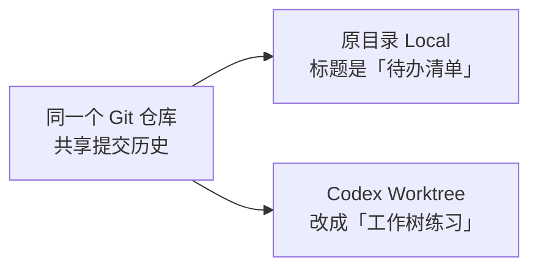
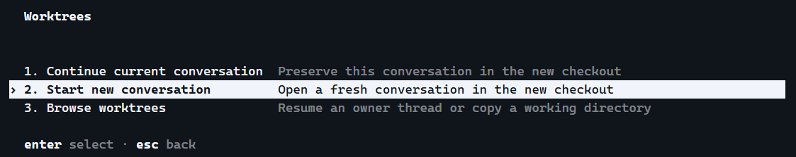

# Git 与 Worktree

[Sourcetree 教程总结（飞书）](https://gcn3z3rurfcz.feishu.cn/wiki/DLA9wWr8Li77OYkwOcxc4YD9n1b)

在 Sourcetree 打开 `todo-workshop`，先认清三个入口。**File Status** 看本次改动和要暂存的文件，**Log / History** 看已经保存的提交，**Branches** 看当前开发分支。提交保存本机版本，**Push** 才向远端发布。第 01 章的首个提交在本机就能看到。

| 你想做什么 | Codex 有什么入口 |
| --- | --- |
| 让 Codex 改你正在编辑的这一份文件 | CLI 在原项目目录运行 `codex`，或在桌面客户端选择 **Local**。 |
| 逐行看它改了什么 | CLI 用 `/diff`，客户端用 **Review** 面板。也可以在 Sourcetree 查看同一目录的差异。 |
| 请 Codex 按需求检查改动 | 输入 `/review`，选择未提交的改动，或与基础分支比较。 |
| 开一项独立任务 | CLI 用 `/worktree`，或在 PowerShell 运行 `codex --worktree`。客户端在新对话选择 **Worktree**。 |
| 把工作树里的成果留下来 | 在客户端的工作树用 **Create branch here** 保存到一个有名字的分支，随后提交。要回日常目录接着做，使用 **Hand off → Local** 移动对话与改动。 |
| 暂存、提交或发布 | 客户端 **Review** 面板也能暂存、撤回、提交和推送。跟练时用 Sourcetree 完成这些 Git 操作。 |

[Codex CLI 指令](https://learn.chatgpt.com/docs/developer-commands?surface=cli) · [Codex 代码审查](https://learn.chatgpt.com/docs/code-review#review-local-changes) · [Codex Worktree 官方指南](https://learn.chatgpt.com/docs/environments/git-worktrees)

## 用两个目录验证 Worktree

分支记录一条开发线。Worktree 是连接到同一 Git 仓库的另一个工作目录。它和原目录共享提交历史与分支信息，各自有一份可编辑的文件。同一个分支默认只能在一个工作树中检出。[Git 工作树文档](https://git-scm.com/docs/git-worktree/zh_HANS-CN)



1. 在 Sourcetree 的 **Log / History** 确认有起点提交，再到 **File Status** 确认第 02 章的标题改动已经撤回。这个练习从干净的工作区开始，便于观察两边的区别。
2. 任选一个入口新建工作树。
   - **CLI**　从练习目录的空闲 Codex 对话输入 `/worktree`，选择 **Start new conversation**。也可以退出到 PowerShell，在同一目录运行 `codex --worktree`。用 `/status` 确认 `Directory` 已切到另一个目录。
   - **客户端**　选中 `todo-workshop` 后开一个新对话，在输入框下选 **Worktree**，以 Sourcetree 当前显示的分支为起点。

   

3. 在新对话发送下面的任务。

```text
请在当前工作树里只把 todos.mjs 的标题改成「工作树练习」。
运行 node todos.mjs 和 node --test，并报告当前目录和结果。
```

你可以在原目录的 PowerShell 运行 `git worktree list`，核对列表里有两个不同的路径。回到原目录运行 `node .\todos.mjs`，标题应仍为「待办清单」。在报告的工作树目录执行同一命令，应看到「工作树练习」。CLI 可用 `/diff` 检查工作树的差异。客户端可打开 **New tab → Terminal** 验证具体输出。

工作树起点有时会显示 **detached HEAD**，意思是它从某个提交开始，还没挂在一个有名字的分支上。想保留成果时，先建分支并确认提交；若只做本课演示，进入后续章节时继续选择 `todo-workshop` 原目录。若 Git 提示分支已在另一个工作树使用，先去该工作树查看改动；需要接到日常目录时再从客户端做 **Hand off**。

下一章 [配置 Codex 与 Magpie](03-config-and-magpie.md)。[五子棋实战的 `implement-spec`](05-matt-pocock.md#5-执行工单或整份规格) 会把这个做法用到多个工单。
